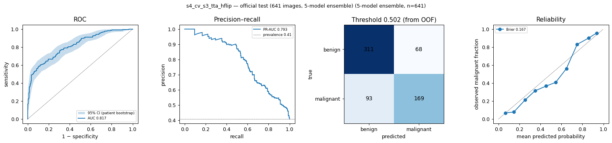
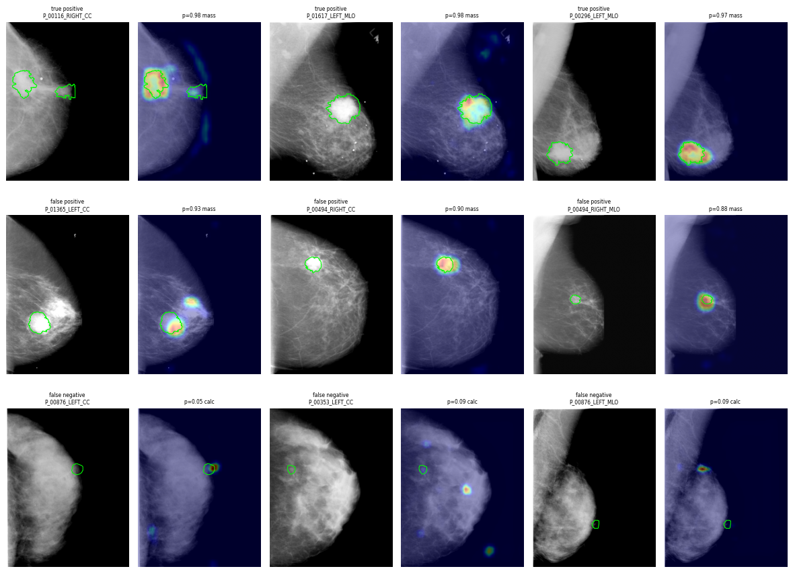

# CBIS-DDSM Whole-Mammogram Malignancy Classifier

[](https://colab.research.google.com/github/Vettel99/cbis-ddsm-mammo-classifier/blob/main/notebooks/cbis_ddsm_whole_image_classifier.ipynb)

Single-view, whole-mammogram **benign vs malignant** classifier trained on CBIS-DDSM on one Colab GPU (an NVIDIA L4 for the published results),
with patient-grouped validation and a single, locked evaluation on the official test split.

> ⚠️ **Not for clinical use.** This is a portfolio and research project. It makes no clinical claims.

**Status:** complete. All milestones (0–18) ran on Colab (an L4 GPU; no A100 was available). Review gates 1–3 were
approved, and the official test split was evaluated once, from a frozen and hashed 5-fold ensemble. The 0.90
validation target was **not** reached; see the results below.

## Results

<!-- RESULTS:START -->
**In plain words:**

- On **641 mammograms the model never saw during development**, it ranks a randomly chosen malignant image above a randomly chosen benign one **82% of the time** (test AUC 0.817, 95% CI 0.774–0.858).
- At the decision threshold fixed before testing, it flags **65% of malignant images** and correctly clears **82% of benign ones**.
- During development (5-fold patient-grouped cross-validation) it scored AUC **0.850 ± 0.025**; the stretch target of 0.90 was **not** reached.

| Metric | Split | Value | 95% CI |
|---|---|---|---|
| `cv_auc_mean` | 5-fold patient-grouped CV in official train (out-of-fold) | 0.8500 ± 0.0246 | — |
| `cv_auc_mean_excluding_selection_fold` | 5-fold patient-grouped CV in official train (out-of-fold), folds ≠ 0 | 0.8527 | — |
| `cv_auc_pooled_oof` | 5-fold patient-grouped CV in official train (out-of-fold) | 0.8434 | [0.8255, 0.8615] |
| `cv_pr_auc_pooled_oof` | 5-fold patient-grouped CV in official train (out-of-fold) | 0.8328 | — |
| `cv_sens_at_spec80` | 5-fold patient-grouped CV in official train (out-of-fold) | 0.7286 | — |
| `cv_sens_at_spec90` | 5-fold patient-grouped CV in official train (out-of-fold) | 0.5991 | — |
| `cv_spec_at_sens90` | 5-fold patient-grouped CV in official train (out-of-fold) | 0.5174 | — |
| `cv_brier_calibrated` | 5-fold patient-grouped CV in official train (out-of-fold) | 0.1586 | — |
| `test_auc_ensemble` | official test (641 images, 5-model ensemble) | 0.8170 | [0.7745, 0.8585] |
| `test_auc_single_model_mean` | official test, each fold model alone | 0.8003 ± 0.0100 | — |
| `test_pr_auc_ensemble` | official test (641 images, 5-model ensemble) | 0.7927 | — |
| `test_sens_at_oof_threshold` | official test (641 images, 5-model ensemble) | 0.6450 | — |
| `test_spec_at_oof_threshold` | official test (641 images, 5-model ensemble) | 0.8206 | — |
| `test_sens_at_spec90` | official test (641 images, 5-model ensemble) | 0.5725 | — |
| `test_brier` | official test (641 images, 5-model ensemble) | 0.1672 | — |

Configuration: `s4_cv_s3_tta_hflip` (train hash `1e9764457296`); 11 configurations evaluated on validation (`experiments.csv`). Fold 0 was the selection fold.

*Generated from `results/metrics.json` (2026-11-12T17:45:48Z) by notebook milestone 17.*
<!-- RESULTS:END -->

### What the model does on the test set



*Left to right: ROC curve with its 95% confidence band, precision–recall curve, confusion matrix at the threshold fixed
on validation data, and a calibration plot (how well predicted probabilities match observed rates).*

### Where the model looks (Grad-CAM)



*Each pair shows a test mammogram and the model's attention heatmap. Green outlines mark the lesion annotated in the
dataset. Rows, top to bottom: malignant lesions correctly flagged, benign lesions wrongly flagged, and malignant
lesions missed. On the test set, missed cancers are more frequent for calcifications than for masses, and in denser
breasts (per-subgroup rates in [`results/error_rates_test.csv`](results/error_rates_test.csv)). More figures, including
error examples and training curves, are in [`results/figures/`](results/figures/).*

### Comparison with published work

Numbers from different splits are **not comparable**; the split column is there to stop that comparison.

| Study | Split | Model | Whole-image AUC |
|---|---|---|---|
| Shen et al. 2019 | Custom patient-level 85/15 (376 test images) | ResNet-50, patch pre-trained, 1152×896 | 0.87 (0.88 TTA) |
| Shen et al. 2019 | Same | 4-model average | 0.91 |
| Petrini et al. 2025 | Official (645 test images) | EfficientNet-B3, single view | 0.8325 ± 0.0171 |
| Petrini et al. 2025 | Official | EfficientNet-B3, two views | 0.8643 ± 0.0241 |
| Wei et al. (via Petrini) | Official / random | 4-model ensemble + TTA | 0.8313 / 0.9427 |
| **This project** | 5-fold CV in official train / official test | EfficientNet-B3, single view, 1536×1184, 5-model ensemble + hflip TTA | `cv_auc_mean` / `test_auc_ensemble` in the Results table |

**Expectation.** Based on the results above, a single-view model on the official test split will most likely land in the
low-to-mid 0.80s. The 0.90 target applies to patient-grouped validation and is a stretch goal. Anything well above the
published numbers gets checked for leakage before it is reported.

## Task

- **Input:** one full-field mammogram (one breast, one view). **Output:** malignancy probability.
- **Label:** 1 if any biopsy-labelled abnormality on the image is `MALIGNANT`; 0 for `BENIGN` / `BENIGN_WITHOUT_CALLBACK`.
- CBIS-DDSM has **no normal images**, so this is benign-vs-malignant among lesion-bearing images — harder than, and not
  comparable to, cancer-vs-normal screening AUCs.
- **Validation:** `StratifiedGroupKFold(5)` grouped by base patient ID inside the official training split.
  **Test:** official split, evaluated once from a frozen, hashed model (`FINAL_EVAL` flag, off by default).

## Data notes (from the metadata run, IDC data v25)

Produced by notebook milestones 4–5 (`results/counts_check.csv`); these are dataset counts, not model results.

- The IDC collection ID is `cbis_ddsm`. All 3,568 CSV abnormality rows match an IDC series by SeriesInstanceUID.
- **IDC metadata defect:** 246 Calc-Test full-mammogram series have DICOM PatientID `P_xxxxx_SIDE_VIEW.dcm` (instead of
  `Calc-Test_P_xxxxx_SIDE_VIEW`) and an empty SeriesDescription. The notebook matches by UID, accepts only that exact
  pattern, and takes split and patient from the CSVs.
- **Image counts vs Petrini Table 1:** the CSVs reference 3,103 distinct full-image series (2,458 train / 645 test),
  matching Petrini. 42 images (38 train, 4 test) are listed in both the mass and calcification CSVs as separate
  series; de-duplicated per image as the PRD specifies, that gives **3,061 images (2,420 train / 641 test)**.
- **Cross-split patients:** 31 base patient IDs appear in both the official train and test splits. They are dropped
  from train/validation (never from test).
- **Orientation:** DDSM films are not consistently oriented relative to the breast-side label, so the preprocessing
  flips each image from its breast mask (chest wall always on the left), not from the side label.
- **Crop limitation:** Otsu + largest-component cropping occasionally keeps a corner of a film label.

## Reproduce

1. Open the notebook in Colab with the badge above and pick a GPU runtime. An **A100** is fastest; the published results
   were produced on an **L4** (GPU-minutes for every run are logged in `results/experiments.csv`). On a
   non-A100 GPU the notebook prints a warning and carries on.
2. Run all. The notebook mounts Drive, downloads the metadata CSVs from TCIA and the full-mammogram DICOMs from NCI
   Imaging Data Commons with `idc-index` (3,103 series, about 102.6 GB per the IDC v25 index: 81.5 GB train, 21.1 GB
   test; test is fetched only when `FINAL_EVAL` is on), and caches the preprocessed images to Drive.
3. It stops at each review gate; set the gate flag in the Config cell after reviewing and re-run.

Data is **not** committed to this repository. A metadata-only check (milestones 0–5 without image download) runs on any
machine: set `cfg.download_dicom = False`.

## Repository layout

```
├── README.md
├── CLAUDE.md                 # rules for Claude Code
├── docs/PRD.md               # specification
├── notebooks/cbis_ddsm_whole_image_classifier.ipynb
├── results/
│   ├── metrics.json          # every reported number, written by code
│   ├── experiments.csv       # every configuration tried
│   └── figures/
├── requirements.txt
└── LICENSE
```

## Limitations

1990s US scanned film (not digital mammography), no normal images, imprecise DDSM lesion annotations, label noise, and a
small validation set per fold. A full model card follows the final evaluation.

## Citations

CBIS-DDSM is licensed under **CC BY 3.0**; please cite:

- Sawyer-Lee, R., Gimenez, F., Hoogi, A., & Rubin, D. (2016). *Curated Breast Imaging Subset of Digital Database for
  Screening Mammography (CBIS-DDSM)* [Data set]. The Cancer Imaging Archive. https://doi.org/10.7937/K9/TCIA.2016.7O02S9CY
- Lee, R. S., Gimenez, F., Hoogi, A., Miyake, K. K., Gorovoy, M., & Rubin, D. L. (2017). A curated mammography data set
  for use in computer-aided detection and diagnosis research. *Scientific Data*, 4, 170177.
- Clark, K., et al. (2013). The Cancer Imaging Archive (TCIA): Maintaining and Operating a Public Information
  Repository. *Journal of Digital Imaging*, 26(6), 1045–1057.
- Fedorov, A., et al. (2023). National Cancer Institute Imaging Data Commons: Toward Transparency, Reproducibility, and
  Scalability in Imaging Artificial Intelligence. *RadioGraphics*, 43(12).

Related work: Shen et al. 2019 (*Scientific Reports*); Petrini et al. 2025 (arXiv:2503.19945).

## License

Code: MIT (see `LICENSE`). Data: CC BY 3.0, not redistributed here.
